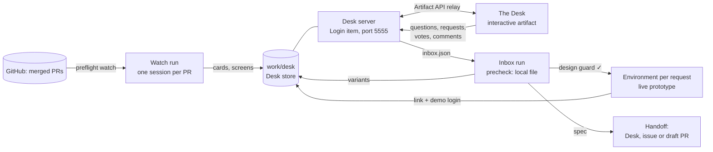

# Design Desk — architecture

This page is for people who maintain or evaluate the agent.
The agent itself never loads it: its operating manual is [`CLAUDE.md`](CLAUDE.md), and its procedures live in [`docs/`](docs/).

Design Desk replaces two earlier tools and keeps everything they could do:

| Earlier tool | What it did | Where it lives now |
| --- | --- | --- |
| `designer` (starter kit) | decks, clickable mockups, walkthroughs, charts, demo videos, copy | the same skills and the same `design` CLI, ported in [`.agents/skills/`](.agents/skills/) and [`toolkit/`](toolkit/) |
| `dam-prototyper` (skill) | 2–3 design approaches for an issue, built into the real screens | the `variants` skill, plus a product profile in the target repository instead of hard-coded paths |

What is new:

1. **It watches what ships.** Every merged pull request that changes the UI becomes a card on the Desk: screenshots, what changed, why it is so, what cannot change and why, and what to look out for — in plain words for a person who does not read code.
2. **The Desk.** One shared page where designers work through those cards like an inbox, ask follow-up questions, file design requests, compare variants, pin comments on elements, and vote.
   Developers and project managers comment on the same page, with their role shown.
3. **Two levels of prototype.** *Variants* are quick, static, on mock data, for discussing direction.
   A *live prototype* is the real product, a branch with the design change, running on its own instance with seeded demo data, which the team opens and clicks through.
4. **A hard design-only boundary.** A request is triaged before any work, and the person is told in plain words what can be done as a design change and what needs a developer.
   A deterministic guard reads every prototype diff and refuses anything beyond presentation.
5. **A developer handoff.** An approved prototype becomes a spec: the change, screens, states, copy, the exact diff, and the questions left for the developer.

## The decisions, and why

| Decision | Why |
| --- | --- |
| One generic agent; everything about one product in a **design profile** inside that product's repository (`.design-desk/<profile>/`) | The pattern the quality inspector proved: the product team keeps the profile current in the same PR that changes the UI, and the agent never hard-codes a product. A repository without a profile still works through a profile the agent detects and the operator confirms (the designer's repo profile). |
| The profile is read from the default branch of a fresh clone, never from a PR branch | Its `bin/` scripts run on the agent's machine; only reviewed content may do that. |
| **One** shared interactive artifact (the Desk), backed by a local server | An agent can make an artifact private or public, never restricted; only the owner can share it with named people. One Desk means one share step at onboarding, and everything else (screens, variants, specs) is served through it. Interactive pages are never public, so nothing leaks by link. |
| The Desk server is a Login item (`startupItems`) on the Artifact API port | The platform relays page requests to a loopback server in the agent's machine, names the caller (`owner` or `viewer`, and the verified email), and wakes the machine for it; the agent must keep the server running itself. |
| Roles come from the operator's roster in `work/CONFIG.md`, matched by the platform-verified email | The page cannot forge the caller headers, so the email is real identity. Unknown viewers are guests: they read and comment, they cannot start expensive work. |
| Viewer prompts are wake-up pings that carry an item id only | A viewer can send any text to the agent. The agent reads the work from its own store, and handles only the closed set of Desk actions. |
| Live prototypes run in **platform Environments**, one per request | An Environment is a sandbox the agent owns, with its own addresses, an access list, an expiry, and no credentials. DAM can install itself into one from a checkout, and rebuilds only the images that changed — for a design change, only the UI. |
| Variants are static HTML on mock data | Fast, cheap, safe to throw away; the `designer` build pipeline already compiles the product's real styles, so a variant looks like the product. |
| The design-only guard is a script, not a prompt rule | "Never change logic" is the rule non-technical requesters rely on. A rule whose violation still produces output is enforced, not narrated: path allow/deny lists from the profile, and a logic fingerprint of every changed component (imports, hooks, handlers, conditions) that must not change. |
| Change cards fan out: one session per merged PR | Each card is independent and expensive (clone, screens, reading the PR and the docs). |
| Nothing is posted on GitHub by default | Design notes on merged PRs are noise for developers. The handoff can file an issue or a draft PR, behind an opt-in. |
| No push by default; the prototype diff is kept as a patch in `work/` | `work/` is backed up; a branch on the target repository is an outward write and an opt-in. |
| Everything the agent does is an **action** done by one **skill**; the platform manages the skills, and a product's profile or the operator names another skill for an action | A product brings its own prototyper or issue writer without a change here; the Desk, the chat, Slack and the schedules start the same actions, and the Desk shows every result ([docs/actions.md](docs/actions.md)). |
| The Desk is the presentation and comment layer; the work is also possible in chat | The team reviews, comments and decides on one shared page; the operator can steer any action turn by turn in chat, and the result still lands on the Desk. |
| The guard reads code through a **language adapter** (`toolkit/lib/lang/`) | TSX/React is the first; a file in a language no adapter reads is refused, so a new stack is a new adapter, never a looser rule. |
| Plain language is a contract | Cards and answers follow the `explain` skill: a gist first, then layers; every "why" is grounded in a PR, a decision record or an architecture page, or it says that it is not documented and who to ask. |

## Components

- **Watch run** (`scripts/preflight.sh watch`, hourly, Precheck): one search call lists PRs merged since the watermark in the watched repositories; a files call per candidate keeps those that touch the profile's UI paths.
  The run keeps the first PR and dispatches the rest; each session reads the PR, its linked issue, its decision block and the architecture pages it touches, captures the screens, and writes one card.
- **Inbox run** (`scripts/preflight.sh inbox`, every 10 min, Precheck over a local file only): questions to answer, requests to triage, variants to make or revise, prototypes to build or update, specs to write, Environments to tear down.
  A viewer's ping starts the same work at once; the claim in the store keeps the two from doing it twice.
- **Monitor** (every 15 min) and **weekly audit**, as every agent made with the creator.
- **On request**: everything the `designer` kit did, from the chat or a Slack DM.

## The design-only boundary

Allowed in a prototype: layout and structure of the markup, styles and design tokens, copy, icons and images, reordering and regrouping existing controls, local view state (open/closed, selected tab), new purely presentational components.

Not allowed: anything that changes what the product does — data it reads or writes, API calls, business rules, validation, permissions, routes, feature flags, dependencies, back-end, infrastructure — and removing a control a user can use today.

The profile names the paths and the presentational imports; `design guard` checks the diff and prints a verdict per file in plain words.
A request is triaged before any work into **design change** (prototype), **needs a developer** (variants and a spec, no live prototype of the logic part) or **product decision** (variants as a concept only).

## State

Everything lives under `work/`, a plain directory backed up to a private repository when one is configured:

| Path | What |
| --- | --- |
| `work/CONFIG.md` | configuration and the Desk roster |
| `work/desk/db.json`, `work/desk/assets/` | the Desk store: cards, threads, votes, screens, variants, specs, patches (one writer: the server) |
| `work/desk/inbox.json` | the work the Desk is waiting for, rewritten by the server on every change |
| `work/CHANGES.tsv` | one row per merged PR seen, written by `scripts/ledger.sh` under a lock |
| `work/output/` | deliverables and their sources |
| `work/logs/`, `work/*.log`, `work/MONITOR.json`, `work/audit/` | logs, the monitor ledger, audit history |

Clones and prototype worktrees live in `$HOME/checkouts/`, outside `work/`, and are rebuilt when missing.

## What is not verified yet

These parts are written against the platform's documented contracts but were not run end to end before the first commit:

- The live prototype engine (`.design-desk/dam/bin/env` in the DAM repository): an Environment install of DAM from a prototype worktree with the backchannel on, the demo account, the UI-only rebuild, and the `tunnel` verb that gives the agent's own browser a local address for screenshots.
- `design capture` against a running install (it signs in through the form the profile's `capture.login` names; the screenshot code itself is the Designer kit's, which is proven).
- The Desk page against the real Artifact API relay (the server and the store have offline tests).

- Figma through the platform: Figma's remote MCP server admits only some MCP clients, so a
  Custom MCP connection with OAuth may be refused; the REST fallback reads frames but cannot
  write layers, and `generate_figma_design` is limited to some clients.
- Pictures attached to GitHub issues with `gh … --attach`, which needs a GitHub CLI that has it.
- The design workspace against the real relay: element picking and text editing run inside
  the option's sandboxed frame, tested only through the local harness.

The first onboarding runs `scripts/verify-onboarding.sh --live`, which probes each of them.

## Not built yet, on purpose

- **A showcase Environment** that runs the latest default branch, so the watch can capture
  live screens of every change; today the screens come from the pull request (DAM requires UI
  proof in every UI PR) or a static rebuild, and `profile.capture.base_url` is the hook for it.
- **Demo data** in a prototype beyond its demo account: DAM's prototype starts empty, like a new
  user's install; a profile `seed/` is the place for it.
- **A harness adapter** (hooks for tool failures and outages, an auto-mode allow list, a tool
  deny list). The push rule is enforced by a git `pre-push` hook instead; merges and
  non-draft PRs stay a written rule until the adapter exists.
- **Anonymous issues on this definition repository**: the audit reports definition bugs to the
  operator only.
